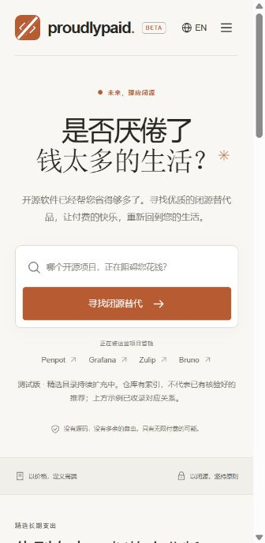

# Proudly Paid.

**Your software is free. Let’s fix that.**

[English](README.md) | **简体中文**

[Live website](https://www.proudlypaid.com/) · [Source code](https://github.com/honglinz07/proudlypaid) · [Suggest an alternative](https://github.com/honglinz07/proudlypaid/issues/new?template=catalog_suggestion.md)

一个一本正经的闭源替代品目录：输入开源项目，探索更昂贵的可能，默认价格从高到低。讽刺的是，这个项目本身 **完全开源**。

An entirely serious directory of closed-source alternatives. Less source. More invoices. Frontend, backend, and original assets are MIT licensed. The source workspaces retain their original `closedsources` package names.

Cloudflare 一体部署入口见 [Worker + D1 + R2 部署说明](docs/deployment-cloudflare.zh-CN.md)：Worker 提供页面和 API，D1 存搜索目录，私有 R2 保存可恢复的数据快照。`npm run check` 包含生产配置的预构建验证；`npm run deploy:cloudflare` 才会实际发布。



## 当前状态

目前是 **轻量搜索测试版（Beta）**：React 前端调用独立的 Workers + D1 API，使用真实仓库索引和带来源的研究目录。价格为注明日期的研究观察，非实时报价。

- 搜索项目名、别名、`owner/repository` 或 HTTPS GitHub 仓库地址，支持子串和有限的拼写纠错；模糊结果需要确认仓库。
- 研究目录含 **24 个项目、34 个产品、54 组关系**；其中 24 个产品完成限定范围的分类审阅，符合发布规则的关系为 37 组，覆盖 19 个项目；其余保留待审状态。
- 可尝试 `Penpot`、`Grafana`、`Zulip`、`Plane`、`Bruno`、`Hoppscotch`、`Appsmith`、`Activepieces`、`Formbricks`。官方站点已导入 66,531 个采集仓库名称与地址；干净克隆默认可使用仓库内的 24 项研究目录。索引数量不等于已有付费推荐的项目数量。
- 区分“没找到仓库”和“仓库找到了，替代品尚待补充”。公开仓库不自动等于开源，未审阅许可证的项目会明确标注。
- 数字价格按币种、单位、展示周期、付款周期分组降序；可选择口径、设置单价上限、展开配置和原始来源。询价和用量模型不参与数字排序。
- 价格是公开计费组件，不代表完整产品账单或同等功能；各组不跨组排名。真实名称不表示合作或背书。
- 中英文切换、移动布局、键盘操作、FAQ、闭源宣言及 404；应用没有账号、统计追踪或搜索历史存储。查询出现在 URL 并发送到 API，托管及代理日志由部署配置决定。
- `/contribute` 支持申请收录、补充替代品和纠正价格；带入搜索上下文，在浏览器中生成可复制/下载的 Markdown 草稿，不会自动发送到本站服务器或 GitHub。

## 快速开始

本地开发需要 **Node.js 24+、npm 11+**。Wrangler 在本地模拟 Worker 和 D1，无需 Cloudflare 账号、GitHub Token 或付费服务。首次安装需要下载开源依赖。

```bash
npm ci
npm run db:local -- --curated-only
npm run dev
```

- 前端：<http://127.0.0.1:5273>
- API 健康检查：<http://127.0.0.1:8787/api/health>
- 也可以分别运行 `npm run dev:web` 和 `npm run dev:api`。
- `Ctrl+C` 停止开发服务器。

`db:local` 检测到 `.local/github-collection/index.jsonl` 时导入其中全部仓库名称与地址，再叠加研究目录；不会修改采集文件或读取 README 正文。没有本地采集文件时只导入研究目录。`npm run db:local -- --curated-only` 可明确选择小目录；数据保存在 `.local/worker-state/`，重启服务无需重复导入。更新研究记录后重新导入即可激活新快照。

## 源码和反馈入口

源码弹窗和反馈页默认链接到 [honglinz07/proudlypaid](https://github.com/honglinz07/proudlypaid)。Fork 部署时，将 `apps/web/.env.example` 复制为同目录的 `.env.local`，把 `VITE_REPOSITORY_URL` 改成自己的真实仓库网页地址。这个值是公开地址，不是令牌。重新启动或构建前端后生效；生产构建也可以通过构建环境覆盖该值。

显式设置 `VITE_REPOSITORY_URL=` 可隐藏 GitHub 链接，反馈页仍能生成、复制和下载线索，并明确说明尚未提交。有仓库链接时，用户自行复制文字、打开 GitHub 模板并确认提交。本站不会代发 issue，也不收集联系信息。贡献规则见英文 [CONTRIBUTING.md](CONTRIBUTING.md)，发布步骤见 [测试版发布说明](docs/release-beta.zh-CN.md)。

## 前后端分离

```text
apps/
  web/                  React + TypeScript + Vite，独立静态前端
    src/components/     搜索框、导航、产品卡片、源码说明
    src/pages/          首页、结果、FAQ、宣言、404
    src/lib/            API 客户端、响应验证、语言状态
    test/               客户端合约与历史演示回归测试
  api/                  Cloudflare Workers + TypeScript，独立 HTTP API
    src/                请求处理、D1 查询与发布规则
    migrations/         版本化数据库结构
    test/               使用本地 D1 的集成测试
packages/contracts/     两版后端共用的版本化 JSON 类型
docs/                   架构、后续接入约定
scripts/                跨平台开发启动器
  github-collector.mjs  可恢复的 GitHub 项目与 README 采集器
test/                   目录数据、采集器与 API 测试
.github/                CI 与贡献模板
```

API 处理函数返回 JSON，不渲染前端页面；前端不导入后端源码。Vite 开发和预览代理把 `/api` 转发至 `127.0.0.1:8787`；一体化生产部署由 Worker 同时提供独立构建的静态资源与 API。主要端点（均支持 GET/HEAD）：

- `/api/health`：数据库就绪状态、搜索能力和当前目录版本。
- `/api/v1/search?q=Penpot`：匹配项目，支持可选 `limit=1..20`。
- `/api/v1/projects/penpot%2Fpenpot/alternatives`：替代品、计费组件、来源、核验日期与待审数量。

完整请求限制、错误码、数据边界和 VPS 后续接入说明见 [架构说明](docs/architecture.md)。

前端端口可通过 `WEB_PORT` 调整。单独启动不同 API 端口时可运行 `node scripts/wrangler.mjs dev --ip 127.0.0.1 --port 9000 --persist-to ../../.local/worker-state`，并给前端设置 `API_PROXY_TARGET=http://127.0.0.1:9000`；环境变量设置语法按所用 shell 调整。

## 检查与构建

```bash
npm run check          # 类型、lint、格式、测试、生产构建
npm run format         # 自动格式化
npm run build          # 两个工作区分别构建
```

前端产物为 `apps/web/dist/`；API 构建执行 Wrangler **dry run** 并输出 `apps/api/dist/`，一体化生产配置的验证输出为 `apps/api/dist/production/`，不会发布到云端。检查会生成绑定类型，并在隔离的临时本地 D1 中运行迁移与搜索测试，不改动日常开发数据库。前端生产预览：`npm run preview --workspace @closedsources/web`（端口 4173），搜索仍需启动 `npm run dev:api`。

## 部署

前端与 API 可以独立构建和部署。官方实例为 <https://www.proudlypaid.com/>，使用 Worker + D1 + 私有 R2；D1 本地配置中的全零 ID 只供开发。生产配置包含官方实例的公开资源标识，Fork 部署需换成自己的域名和数据库，步骤见 [Cloudflare 部署说明](docs/deployment-cloudflare.zh-CN.md)。代码部署不会执行数据库导入；任何远程迁移或导入之前，都应先检查指南中的 D1 写入预算。

- **前端**：将 `apps/web/dist/` 部署至静态主机，提供构建生成的各路由 HTML。构建会生成静态正文、元信息、`robots.txt`、站点地图与自定义 404；Cloudflare 生产配置对未知页面返回 HTTP 404，同时保留客户端导航。Fork 应把 `VITE_SITE_URL` 设为自己的 HTTPS 站点地址，详见[搜索引擎发现说明](docs/search-discovery.zh-CN.md)，包括单独的 Search Console 所有权验证与提交步骤。
- **API**：部署至 Cloudflare Workers，绑定自己的 D1、应用迁移并导入目录。步骤见 [轻量版部署说明](docs/deployment-lite.zh-CN.md)。云端资源与费用取决于部署账号及服务规则。
- **连接方式**：生产网关必须先把 `/api` 和 `/api/*` 转发给 API，再处理静态页面；浏览器使用同源相对路径，生产环境不依赖 Vite 代理。当前没有跨域直连配置。
- **VPS 语义版**：尚未实现。后续复用目录、JSON 合约及核验规则，增加 PostgreSQL/pgvector 存储和语义检索适配器。

## GitHub 与开源

研究目录已扩充到 **24 个项目、34 个产品、54 组对应关系**，包含原始来源、许可证范围、价格配置、逐条核验日期与待核验状态。详见 [目录记录](data/catalog/README.md)、[本批结果](data/catalog/batches/2026-10-20-api-automation-forms.md) 和 [JSON 数据](data/catalog/pilot.json)。当前搜索接入其中符合发布规则的记录，尚不构成广泛覆盖的产品目录。

`npm run catalog:discover` 可以离线扫描已采集 README 的替代声明，将带行号、内容哈希的候选写入 `.local/catalog-discovery/run-*/`；候选不会自动当作闭源产品或已核验关系。后续如何查找官网、核验付费产品、记录价格并服务于 Workers/VPS 两版后端，见 [目录扩充方案](docs/catalog-expansion-plan.md)。

`npm run catalog:group -- --input <candidates.jsonl>` 使用发现用产品身份表归并指定批次，输出待核验产品组、未识别线索和哈希报告到 `.local/catalog-review/run-*/`。归并结果保留全部原始证据，不会自动写入研究目录。

公开源码位于 [honglinz07/proudlypaid](https://github.com/honglinz07/proudlypaid)，包含前后端、原创研究目录、锁文件、CI、贡献说明与 issue / PR 模板。欢迎提交功能建议、问题报告和付费替代品线索。

独立 GitHub 采集器目标是 GitHub 上全部 Star ≥ 1000 的公开仓库，明确包含 Fork，不按类型、语言或许可证筛选。每条目录索引只保存仓库全名、网页地址和本地 README 文件路径。它支持搜索分段、断点恢复、运行状态和文件校验；本地导入名称索引不代表原始全量采集已无缺口，采集报告仍保留未决搜索分段和 README 状态。

需要 Node.js 24+。设置环境变量 `GH_TOKEN` 或 `GITHUB_TOKEN` 可使用已有 GitHub 凭据并获得更高 API 配额；没有令牌时也可以读取公开仓库，但会受到较低的未认证配额限制。Windows 用户可运行 `scripts/collect-github.ps1`，通过隐藏输入提供令牌，并在速率限制重置后自动续跑。令牌不会写入项目文件。

```bash
npm run github:collect
npm run github:status
npm run github:verify
```

采集输出默认保存在被 Git 忽略的 `.local/github-collection/`。`npm run github:collect -- --max-requests 5` 可限制单次运行的请求数，方便小规模联通验证；这不会缩小正式采集目标。使用 `--retry-failed` 可重试此前失败的 README。

网络请求经过已有的有限重试仍失败时，采集器会停止并保留当前项目和搜索分段的进度，输出具体系统错误码（例如 DNS 解析失败的 `ENOTFOUND`、权限拒绝的 `EACCES` 或连接超时的 `UND_ERR_CONNECT_TIMEOUT`），不会继续把其余仓库批量标成失败。确认网络恢复后重新运行即可。命令沙盒的网络权限与普通终端可能不同；Windows 长时间采集请在普通 PowerShell 中启动。系统代理开启不代表 Node.js 自动使用了代理，需按所用 Node.js 版本单独配置；本工具不会修改系统代理设置。

Windows 用户可以在隐藏输入令牌后，一并重试旧的失败记录（已成功的 README 不会重新下载）：

```powershell
.\scripts\collect-github.ps1 -RetryFailed
```

## 文档导航

| 文档 | English | 简体中文 |
| --- | --- | --- |
| 项目说明与本地运行 | [README](README.md) | [项目说明](README.zh-CN.md) |
| Worker + D1 + R2 | [Cloudflare deployment](docs/deployment-cloudflare.md) | [Cloudflare 部署](docs/deployment-cloudflare.zh-CN.md) |
| 前后端独立部署 | [Lightweight deployment](docs/deployment-lite.md) | [轻量版部署](docs/deployment-lite.zh-CN.md) |
| 测试版发布与验证 | [Beta release](docs/release-beta.md) | [测试版发布](docs/release-beta.zh-CN.md) |
| 搜索引擎发现 | [Search discovery](docs/search-discovery.md) | [搜索引擎发现](docs/search-discovery.zh-CN.md) |

[架构说明](docs/architecture.md)和[贡献指南](CONTRIBUTING.md)目前为英文；历史研究批次、目录扩充计划与原始采集任务书保留中文和原始日期。

## 许可证与贡献

全部原创前端、后端、CSS、SVG 图标、文档与研究摘要使用 [MIT License](LICENSE)。依赖使用各自的开源许可证，记录在 `package-lock.json`。第三方 README 保留原作者与许可证，不随本地数据自动发布。系统字体由运行设备提供，不分发商业字体。本地运行不需要付费服务；应用不接入统计追踪，Wrangler 工具指标收集也已关闭。

欢迎贡献，参见 [CONTRIBUTING.md](CONTRIBUTING.md)。

> We used open source to help you stop using open source. We understand how this looks.
